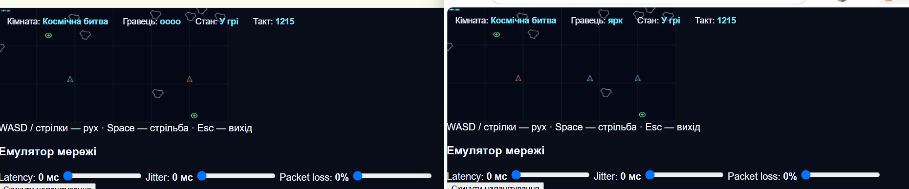


##  Лабораторна робота № 4 — Node.js, EventEmitter, потоки та WebSocket

### 1. Мета роботи

Мета роботи — отримати практичні навички розроблення серверної частини застосунку на Node.js, роботи з HTTP і WebSocket, використання `EventEmitter`, потоків даних, обробки помилок і керування ресурсами.

### 2. Архітектура застосунку

Проєкт поділено на дві основні частини:

- `client/` — клієнтська частина гри, побудована за допомогою Vite.
- `server/` — серверна частина на Node.js, яка обробляє HTTP-запити, API кімнат, WebSocket-з'єднання та журналювання подій.

HTTP-сервер обслуговує клієнтську сторінку, надає API та перевіряє стан сервера через маршрут `/health`. WebSocket використовується для обміну повідомленнями між клієнтами та сервером.

### 3. Event Loop у Node.js

Node.js використовує модель виконання JavaScript з одним основним потоком виконання. Цикл подій (Event Loop) дає змогу обробляти асинхронні операції, зокрема мережеві запити, таймери та операції введення-виведення, без блокування основного потоку на час очікування їх завершення.

Важливі складові:

- **Timers** — виконання callback-функцій таймерів, коли вони готові до запуску.
- **Poll** — очікування та обробка подій введення-виведення.
- **Check** — виконання callback-функцій `setImmediate()`.
- **Close callbacks** — обробка подій закриття ресурсів.
- **Microtasks** — обробники Promise, які виконуються відповідно до правил черги мікрозадач.

Якщо обробник HTTP-запиту синхронно блокує основний потік на 300 мс, у цей час Node.js не може виконувати інший JavaScript-код у цьому потоці. Через це затримуються відповіді іншим клієнтам, обробка повідомлень WebSocket і таймери. Тому тривалі обчислення не варто виконувати синхронно в обробниках запитів.

### 4. EventEmitter та обробка помилок

`EventEmitter` дає змогу об'єктам генерувати події та викликати зареєстровані обробники. У проєкті клас `Room` успадковує `EventEmitter` і повідомляє про приєднання та вихід гравців, а також про спорожнення кімнати.

Подія `error` у Node.js має особливе значення. Якщо `EventEmitter` генерує подію `error`, але для неї немає зареєстрованого обробника, Node.js зазвичай викидає виняток і завершує процес. Тому для серверних компонентів необхідно передбачати обробку помилок.

### 5. Потокове журналювання та backpressure

Журнал подій записується у форматі NDJSON: кожен рядок містить окремий JSON-об'єкт. Для формування записів використовується `Transform`, а передавання даних у файл організовано через потік і `pipeline()`.

Потокова обробка дає змогу передавати дані частинами, не накопичуючи весь файл у пам'яті. Backpressure — механізм регулювання швидкості передавання даних, коли споживач не встигає їх обробляти. Це допомагає обмежувати зростання буферів і використання пам'яті.

### 6. Вимірювання RSS

RSS (Resident Set Size) — обсяг фізичної пам'яті, який займає процес. Для оцінювання споживання пам'яті під час передавання великого файлу потрібно записувати значення RSS упродовж тесту та побудувати графік за фактичними вимірюваннями.

У потоковій реалізації очікується, що використання пам'яті залишатиметься відносно стабільним, якщо розміри буферів обмежені та backpressure коректно працює. Фактичний результат залежить від розміру чанків, буферів, швидкості споживача та інших чинників.

**Графік RSS:** додати після виконання вимірювання під час передавання великого журналу через повільний канал.

### 7. Результати перевірки HTTP-сервера

Під час перевірки сервера отримано такі результати:

| Перевірка | Очікуваний результат |
|---|---|
| `GET /health` | `200 OK`, статус `ok` |
| `GET /api/rooms` | `200 OK`, список кімнат у форматі JSON |
| `GET /` | `200 OK`, HTML клієнтської гри |
| Запит із `../` у шляху | `403 Forbidden` |
| Запит із `%2e%2e` у шляху | `403 Forbidden` |

Результати підтверджують роботу перевірених HTTP-маршрутів і блокування двох варіантів переходу до батьківських каталогів.

### 8. Висновок

Під час лабораторної роботи реалізовано серверну частину гри на Node.js, HTTP API для кімнат, WebSocket-з'єднання та потокове журналювання подій. Розглянуто використання `EventEmitter`, цикл подій Node.js, обробку помилок, потокове передавання даних і механізм backpressure. Перевірено доступність основних HTTP-маршрутів і захист статичних ресурсів від небезпечних шляхів.

---

# Лабораторна робота №5 — Multiplayer Networking

## 1. Мета роботи

Реалізувати багатокористувацький режим гри з авторитетною серверною симуляцією, синхронізацією стану гравців, клієнтським прогнозуванням та бінарним мережевим протоколом.

## 2. Архітектура мережевої взаємодії

У проєкті використовуються три основні частини:

- `client/` — клієнтська частина гри, обробка введення, відображення та мережевої синхронізації.
- `server/` — серверна частина, обробка WebSocket-повідомлень, кімнат, команд гравців і симуляції.
- `shared/` — спільна логіка симуляції корабля та бінарний протокол, доступні клієнту й серверу.

Сервер є авторитетним джерелом ігрового стану. Клієнт надсилає команди керування (`throttle`, `turn`, `shoot`) із послідовним номером `seq`, а не координати корабля.

## 3. Серверна симуляція

Сервер виконує симуляцію з частотою 30 тіків на секунду. Для керування часом використовується планування наступного виконання за цільовим часом, а не звичайний `setInterval`.

Команди гравців перевіряються та додаються до черги введення. Сервер обробляє команди, оновлює стан кораблів і формує знімки стану (`snapshots`) для клієнтів.

## 4. Client-side prediction та reconciliation

Для зменшення відчутної затримки реалізовано:

- **Client-side prediction** — локальний клієнт прогнозує рух власного корабля відразу після введення команди.
- **Server reconciliation** — після отримання серверного знімка клієнт відновлює підтверджений стан і повторно застосовує непідтверджені команди.
- **Correction smoothing** — згладжування візуальної корекції локального корабля приблизно за 100 мс.
- **Remote interpolation** — інтерполяція руху віддалених кораблів між серверними знімками із затримкою приблизно 100 мс.

## 5. Порівняння JSON та Binary Protocol

У грі передбачено два режими мережевого обміну.

| Критерій | JSON | Binary |
|---|---|---|
| Формат | Текстовий | Бінарний |
| Кодування | `JSON.stringify()` | `ArrayBuffer` та `DataView` |
| Декодування | `JSON.parse()` | `DataView` |
| Представлення чисел | Текстове | Числові типи фіксованої довжини |
| Розмір повідомлення | Залежить від текстового представлення | Компактне бінарне представлення |
| Налагодження | Просте, повідомлення можна читати | Потребує декодера |
| Основна перевага | Зручність розробки | Ефективність передачі даних |

Бінарний протокол використовує little-endian порядок байтів. Для передачі кута використовується `Int16`. Версія протоколу та структура повідомлень визначаються у спільному модулі.

## 6. Емуляція мережевих умов та моніторинг

Для тестування мережевої взаємодії реалізовано емуляцію:

- затримки (latency);
- джитеру (jitter);
- втрати пакетів (packet loss).

Для моніторингу мережі відображаються:

- RTT — час проходження запиту та відповіді;
- Snapshot age — вік останнього отриманого знімка;
- Bytes/s — швидкість передачі даних;
- Input queue — кількість непідтверджених команд;
- Correction size — величина корекції прогнозованого стану.

## 7. Демонстрація

Нижче розміщується GIF із демонстрацією двох гравців у двох вікнах браузера.

## 8. Аналіз мережевої взаємодії

За наявності мережевої затримки клієнт отримує серверні знімки пізніше. Client-side prediction дає змогу локальному гравцеві продовжувати керування без очікування відповіді сервера.

Після отримання знімка виконується reconciliation: клієнт відновлює підтверджений сервером стан і повторно застосовує команди, які ще не були підтверджені сервером.

Інтерполяція віддалених кораблів забезпечує плавніше відображення їхнього руху. Для цього використовується буфер серверних знімків із затримкою приблизно 100 мс. Такий підхід створює компроміс між плавністю руху та актуальністю відображуваного стану.

Авторитетна серверна симуляція ускладнює підміну координат клієнтом, оскільки клієнт надсилає команди керування, а остаточний стан ігрового світу визначає сервер.

Емуляція затримки, джитеру та втрати пакетів дає змогу перевірити поведінку мережевої синхронізації за різних умов з'єднання.

## 9. Висновок

Під час лабораторної роботи реалізовано багатокористувацький режим гри з авторитетною серверною симуляцією. Створено механізми client-side prediction, server reconciliation та інтерполяції віддалених гравців. Реалізовано бінарний протокол передачі даних, перемикання між JSON і Binary, емуляцію мережевих проблем та моніторинг мережевих показників.

